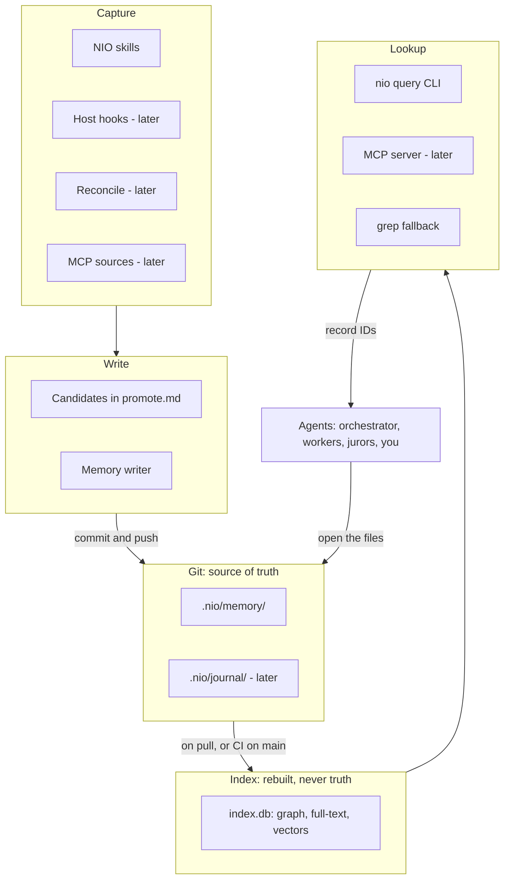

# Nio memory north star

Last updated 2026-10-24. Owner: Nikolaj. Read with `NORTH_STAR.md`; this file is the source of truth for memory.

This is the build spec for NIO's memory, its first feature. It records decisions only; the reasoning behind them is in the design doc's version history. Build v0 first (see the last sections); everything marked "later" waits until v0 proves agents write good records and use them.

## What memory is for

Memory answers three questions for any agent, on any host, for any teammate:

1. **Why was X done this way?**
2. **Was this done before, and can I reuse it?**
3. **Did the jury approve it, and what did it reject?**

Principles:

- **Files in git are the truth.** Markdown records, committed and shared through git. No database or daemon is ever the source of truth.
- **The index is a cache.** Graph, full-text and vector lookup live in a local index rebuilt from the files. Deleting it loses nothing.
- **No lock-in.** Any outside tool (Cognee, a hosted database) only ever holds a copy and can be dropped with one reindex.
- **Agent-agnostic.** Skills are plain instructions; the `nio` CLI does what instructions cannot do reliably. MCP and host hooks are optional extras.
- **Quality and reading are enforced,** not hoped for.

## Decisions

| Topic | Decision |
| --- | --- |
| Source of truth | markdown records in `.nio/memory/`, committed to git |
| Folder | everything under `.nio/` |
| Layout | one folder per area of the project, areas listed in team config; no date folders, no type folders, no repo-mirrored tree |
| Record types | decision, verdict, lesson, change request |
| Code context | not stored as memory; derived from code into the index |
| Who writes | one configured memory-writer role; other agents only add candidates |
| Index | built in from v0: SQLite with graph, full-text (FTS5) and vectors (`sqlite-vec`) in `.nio/cache/index.db` |
| Embedding model | `bge-small-en-v1.5` by default, pinned in team config; swap if recall is poor |
| Scripts | Python package `nio`, installed with `uv` (`uv tool install` or `uvx`) |
| Team sync | git carries records; each machine re-indexes incrementally after every pull |
| Hosted index | later, optional: Postgres with pgvector, CI as the only writer |
| claude-mem | not used; inspiration only |
| Cognee | not used in v0; optional backend later |
| Google Memory Bank | rejected |
| Dogfooding | NIO keeps its own memory in this repo's `.nio/memory/` from step 0 |
| Entry point | `@nio:remember` works by hand in any session, so memory does not wait for the pipeline |
| AC and task IDs | optional free-form strings until the spec and task templates fix the format |
| `INDEX.md` | generated into `.nio/cache/`, gitignored, so it never conflicts in a merge |

## How it fits together

Writes go down into git, the index is rebuilt from git, and lookups return IDs that agents resolve by opening the committed files. v0 uses NIO skills for capture and the CLI and grep for lookup; host hooks, reconcile, MCP sources and the MCP server come later.



## Folder layout

```
.nio/
  config.json                      # team config, committed (memory block below)
  config.local.json                # personal overrides, gitignored
  memory/                          # long-term, committed
    auth/                          # one folder per area
      D-261024-7kq2-sessions-in-redis.md      # decision
      V-261024-p9x1-sessions-in-redis.md      # jury verdict on it
      L-261026-c4m8-retry-flaky-webhooks.md   # lesson
    checkout/
      C-261025-h2n5-spec-misses-sso.md        # change request
    project/                       # verdicts on whole stages (spec, plan, tasks)
  runs/                            # short-term, gitignored; `nio run` starts one
    R-261024-a1b2/
      scratch.md                   # working notes, fixed headings
      promote.md                   # candidates for long-term memory
      packs/                       # context packs
      jury/                        # raw juror output
  cache/                           # gitignored
    INDEX.md                       # generated: one line per record, plus a by-path section
    index.db                       # graph, full-text, vectors
    usage.log                      # which IDs each lookup returned
  journal/                         # later: session log from host hooks
```

Specs, plans and tasks live wherever the artifact templates put them; memory points at them by ID and never copies them.

## Record format

YAML frontmatter that tools read, plus a short body that agents read. A body stays under 40 lines.

```markdown
---
id: D-261024-7kq2
type: decision            # decision | verdict | lesson | change
title: Store sessions in Redis, not Postgres
status: proposed          # proposed | human | recorded
answers: why              # why | reuse | jury: which memory question it answers
date: 2026-10-24
by: builder / claude-code / sonnet   # role / host / model, or `human`
run: R-261024-a1b2
serves: [AC-014]
task: T-031
paths: [src/session/**, src/config/redis.ts]
tags: [sessions, caching]
supersedes: []
---
## Decision
One or two sentences.
## Why
The reason, and the constraint that forced it.
## Rejected alternatives
- Postgres sessions table: adds a write on every request.
## Reuse
When this applies again, and what to copy.
```

| Type | Written when | Extra fields | Body sections |
| --- | --- | --- | --- |
| decision | an agent makes a call the task did not dictate | `serves`, `task` | Decision, Why, Rejected alternatives, Reuse |
| verdict | every jury ruling, always | `subject` (a D or T ID), `outcome` (approved, rejected, human), `tier` (low, medium, high) | Ruling, Jurors (a table of lens, host, model and vote), Reasons, What was rejected |
| lesson | a reusable solution is found | `paths`, `tags` | Problem, Solution, Where it applies |
| change | implementation shows the spec or plan is wrong | `against`, `outcome` (pending, accepted, rejected) | What is wrong, Proposed change, Human decision |

- **IDs:** `<type letter>-<yymmdd>-<4 random base32>`. Random suffixes cannot collide across branches; the filename starts with the ID, so `**/<id>*.md` finds any record.
- **Meaning is never edited; addresses and flags may be.** A changed decision is a new record with `supersedes`, and in the same change the old record gets `outdated_by: [<new ID>]`, so anyone opening the old file sees it is outdated. A change request against a record flags it the same way. Once committed, a record may change only `paths` (to repoint it at code git could not follow, such as a split file) and `outdated_by` (which only grows), and moving a file to another area with `git mv` is allowed. `nio check --base <ref>` rejects any other change to a record committed at `<ref>`, and requires `outdated_by` and `supersedes` / `against` to agree both ways.

## Areas

Records are grouped by **area**: a part of the project such as a subsystem or module (`auth/`, `payments/`; for NIO itself, `records/`, `index/`, `jury/`). The folder is for people browsing; agents find records through the index and `paths`, never through folders.

- **The list is in team config** (`memory.areas`). `nio check` rejects a record in a folder that is not on the list.
- **New areas need the human.** The writer proposes a name when nothing fits; it never creates a folder on its own. This stops `host/`, `hosts/` and `cross-host/` all appearing.
- **One area per record.** A record that spans areas goes in its main one; the others become tags.
- **The folder is the area.** There is no `area` field in frontmatter, so the two can never disagree.
- **Verdicts sit next to their subject,** in the subject's area. Verdicts on a whole stage (spec, plan, tasks) go in the fixed `project/` area.
- **Renaming an area** is one `git mv` commit; IDs and links do not change.
- **One state field per type.** Decisions and lessons have `status`; verdicts and change requests have `outcome` instead, because nobody approves a verdict itself. Whether a decision still holds is its `standing`, which the index derives (see Index).
- **`status` values** say how the record entered memory: `proposed` (written by an agent), `human` (a human decided it directly), `recorded` (written after the fact by reconcile). Jury standing is never stored on the record: "approved" and "rejected" mean a verdict with that `outcome` names it as `subject`, because a record written before its verdict could never be updated.
- **Links point backward,** from the newer record (a verdict names its `subject`). The only forward link is `outdated_by`; a verdict never edits the decision.
- **`run`:** the run ID that produced the record; empty for records written by hand.
- **Traceability chain:** requirement → AC → task → commit → decision → verdict. Every link is a frontmatter field except the commit, which the index derives as the commit that added the record (`git log --diff-filter=A`), because a record cannot hold the hash of the commit it is part of.
- **`by`:** `role / host / model` for an agent, `human` for a decision a person made.

**Why markdown with YAML frontmatter:** agents read the markdown body; scripts read the frontmatter fields, which must parse exactly for the index, lint and conflict checks. It is the same format as `SKILL.md`. Config stays JSON, because it is settings for tools, validated by a JSON Schema.

**Frontmatter rules:**

- **Flat only:** single values and lists of plain strings, never nested objects. Anything structured (such as juror votes) goes in a body table.
- **Small:** about 10 to 14 fields; explanations belong in the body.
- **Strict parsing:** a schema per type, a YAML 1.2 loader, and quoted strings wherever a value could be misread (so `no` never becomes `false` and dates never change type). `nio index --check` validates every header.

## Writing memory

One configured writer owns `.nio/memory/`; every other agent only adds candidates. NIO pipeline events trigger writes, so it works on any host.

```json
{
  "memory": {
    "areas": ["auth", "payments", "checkout", "project"],
    "writer": { "role": "memory-keeper", "host": "claude-code", "model": "haiku", "effort": "low" },
    "candidates": { "from": ["builder", "tdd", "test-writer", "adversarial-evaluator", "juror"], "maxPerTask": 5 },
    "on": {
      "jury.verdict":   "write",
      "change.request": "write",
      "task.done":      "candidate",
      "epic.done":      "promote",
      "stage.approved": "promote",
      "run.end":        "promote"
    },
    "promote": { "jury": "when-superseding" },
    "index": { "store": "sqlite", "model": "BAAI/bge-small-en-v1.5", "vectors": "int8", "drift": 0.3 }
  }
}
```

| Action | What happens | Who |
| --- | --- | --- |
| `write` | record written now, no promotion | writer |
| `candidate` | what the agent decided is appended to the run's `promote.md` | acting agent |
| `promote` | writer reads `promote.md`, applies the admission rule and dedup, writes records, reindexes | writer |
| `off` | nothing |  |

Each skill's instructions end with the step that fires its event (for example "emit `task.done`: append your candidates"), so no host hooks are needed in v0. Verdicts and change requests skip promotion because traceability needs every one.

## Index

`nio index` builds `.nio/cache/index.db` from the committed files. Nothing in it is the source of truth.

| Table | Holds | Built from |
| --- | --- | --- |
| `nodes` | records, AC and task IDs, files | frontmatter, `git ls-files` |
| `edges` | `serves`, `task`, `subject`, `supersedes`, `commit` (derived from git), `touches` (record to file: globs expanded against `git ls-files`, plus the files they matched when the record was committed, followed through git renames) | frontmatter |
| `fts` | full-text over titles and bodies | SQLite FTS5 |
| `vec` | one int8 embedding per record | `sqlite-vec` and `fastembed` with the pinned model |
| `meta` | model and version, last indexed commit, content hash per record | indexer |

- **Incremental:** content hashes decide what to re-embed; unchanged records are never touched.
- **Standing:** each decision and lesson gets one derived `standing`, first match wins:

  | Standing | When |
  | --- | --- |
  | `conflict` | two records that no verdict rejected supersede it |
  | `superseded` | a record that no verdict rejected supersedes it, or an accepted change request is against it |
  | `challenged` | a pending change request is against it |
  | `rejected`, `escalated` | its newest verdict's outcome is `rejected` or `human` |
  | `drifted` | `memory.index.drift` (default 30%) of the lines in its touched files changed since its commit or its newest verdict, whichever is later, following renames |
  | `uncommitted` | not committed yet |
  | `approved` | its newest verdict approved it |
  | `current` | none of the above |

  Verdicts and change requests have their `outcome` as standing. To clear `drifted`, recheck the decision against the code: write a verdict if it still holds, or supersede it.
- **Never blocks git:** the git hook starts `nio index` in the background. A query during indexing uses the existing index and greps the changed files.
- **`nio index --check`:** the lint and conflict checks (Quality and Team conflicts sections), run by the indexer and in CI.
- **`INDEX.md`:** regenerated into `.nio/cache/` on every run; never committed.
- **Expected cost** (measured on a 4-core sandbox with `sqlite-vec` 0.1.9): 10,000 items is about 4 MB of int8 vectors with about 10 ms queries; 100,000 items is about 41 MB with 66 ms queries.
- **Embedding speed** (measured 2026-10-24, `fastembed` on a 12-core CPU, records of about 100 words): about 40 ms per record, so 1,000 records take about 40 s. The model is a 65 MB download, once per machine, and takes a few seconds to load. A typical pull re-embeds a handful of records, so model load dominates; a fresh clone or a model change re-embeds everything in a minute or two.

## Lookup

`nio query` returns record IDs; the agent then opens the files. It works in three steps: find IDs, get graph context, read at most 5 bodies.

| Need | Command | Returns |
| --- | --- | --- |
| Decisions on a file | `nio query --path <file>` | one line per hit: ID, type, status or outcome, title |
| Why, and did the jury approve | `nio query --graph <id> --depth 2` | linked IDs: superseding records, verdicts, AC, task, files |
| Done before? | `nio query "<question>"` | hybrid: full-text and vector results merged by rank, expanded one graph hop |
| Is this candidate a duplicate? | `nio query "<title>. Decision: … Why: …" --path <file>...` | the same hybrid search with similarity; `≈` marks 0.85 or more, looser than the 0.92 CI warning |
| Read | `nio get <id>...` | bodies, at most 5 |
| Freshness | `nio status` | last indexed commit against `HEAD`, model, store |

- Results skip `superseded` and `rejected` records unless asked, and show `conflict`, `challenged` and `drifted` with a warning: verify a drifted decision against the code before relying on it.
- **Fallback:** if the index is missing or stale, the skill greps the records' frontmatter in `.nio/memory/`. Lookup never fails because the index is down.
- Never preload the whole `INDEX.md`; at 1,000 records it is about 25,000 tokens.

## Quality

A record is only useful if a new agent can act on it alone. Cheap checks come first, a model last.

1. **Lint, no model.** `nio check` (also run by `nio index --check`) rejects a record with a missing required field, a folder that is not a listed area, an empty Why, a Why that only repeats the Decision, a link to an ID that does not exist, a verdict outside its subject's area, more than 40 body lines, or a leftover `TODO` from the template. Promotion cannot commit a failing record. `paths` must match a tracked or untracked-but-not-ignored file when the record is written, so a record can describe code from the same change; later, a path is followed through git renames, and one that still matches nothing (the code was deleted, or split in a way git cannot follow) is only a warning; the fix is to edit `paths` or supersede the record.
2. **Admission rule.** A candidate becomes a record only if it answers one of the three memory questions, named in `answers:`.
3. **Dedup before writing.** The writer queries the candidate's paths and text first; a close match on the same paths becomes a supersede, never a second record.
4. **Spot-check juror.** One cheap juror reviews every record that supersedes an approved decision, plus a sample of the rest, asking: could a new agent understand why from this record alone? A fail goes back to the writer.
5. **Usage log.** Every lookup and context pack appends the IDs it returned to `.nio/cache/usage.log`. v0 only logs; analysis comes later.

## Forced reads

Agents do not reliably look things up on their own, so in v0 reading memory is not their choice.

- **Context packs.** `nio pack <task>` runs `nio query --path` for every file in the task's scope and a one-hop graph walk on its AC, then adds the index lines and the full text of the top 3 records, capped at about 1,500 tokens. The worker starts with them in context.
- **Jurors enforce it.** A juror's pack includes the approved decisions touching the diff's paths, and every juror gets one more lens: does this diff contradict an approved decision without a change request? If so, reject.
- **Files outside the pack.** The skill tells the worker to run `nio query --path` before editing a file the pack did not cover.

## Team conflicts

Git merges the files; `nio index --check` finds what git cannot see. It runs in the git `post-merge` hook and as a CI check on pull requests (`--base origin/main`), so a conflict blocks the merge.

| Conflict | Detected by | Resolution |
| --- | --- | --- |
| Two branches supersede the same decision | two records that no verdict rejected list it in `supersedes` | CI fails; NIO writes a change request and the human picks one |
| Two branches add the same decision | high similarity and overlapping `paths` between two new records | CI warns; the next promotion merges them |

Because a record's meaning is never edited, git reports a conflict inside `.nio/memory/` only when two branches change the same record's `paths` or `outdated_by`. Two branches flagging the same record is the supersede conflict above, so git surfaces it at merge time.

Until resolved, lookup returns both records with a `conflict` flag.

## v0: the memory MVP

v0 proves that agents write good records and use them. NIO dogfoods it on this repo. Build in this order:

0. **Hand-written records:** the decisions above, written as records in `.nio/memory/`, to test the format before any code exists.
1. **Record format:** templates for the four types, the ID generator, `nio check`, and the `nio` Python package skeleton (`uv`).
2. **`@nio:remember` skill:** record a decision by hand, write a verdict, add a candidate, promote with the admission rule and dedup.
3. **`nio index`:** SQLite graph, FTS5 and `sqlite-vec` vectors with `bge-small-en-v1.5`, incremental by content hash, `INDEX.md` generation, and `--check`.
4. **`nio query` and `nio get`:** path, graph, hybrid text, with the grep fallback.
5. **`nio pack`:** memory in every context pack.
6. **Juror lenses:** respects approved decisions; the spot-check juror.
7. **Sync:** git `post-merge`, `post-checkout` and `post-rewrite` hooks running `nio index` in the background, the session-start freshness check, and the CI check.
8. **Usage log.**

**Rough goals, not gates:** across about 20 real tasks on two branches, the relevant decision reaches the context pack in most tasks, almost no duplicate records survive a merge, and CI catches every cross-branch supersede conflict.

## Later

In rough order, each only once v0 holds:

- **Journal and host hooks.** `.nio/journal/<yyyy-mm>.md`, one short entry per stretch of work, written by `nio journal hook <host> <event>` with no LLM in the hook. Claude Code and Codex: `SessionStart`, `PostToolUse`, `Stop`, `SessionEnd`, `PreCompact`, `SubagentStop`. Antigravity (`agy`): `SessionStart`, `PostToolUse`, `Stop`. A resume pack (about 2,000 tokens) at session start.
- **`@nio:reconcile-memory`.** Reads commits since a `reconciled:` marker, writes `status: recorded` records through promotion, and raises a change request when a commit undoes an approved decision.
- **MCP server `nio-memory`.** Six tools over the same CLI: `memory_find`, `memory_graph`, `memory_get`, `memory_record`, `memory_promote`, `memory_status`; write tools check the caller's role.
- **Code graph.** tree-sitter symbols, imports and calls in the same index, embedded as signature plus docstring.
- **Postgres store.** Local, or hosted with pgvector, CI on main as the only writer, and a local SQLite overlay for unmerged records.
- **Cognee and MCP sources.** Optional backends that only receive copies and return IDs; anything they produce is a candidate.

## Open items for the builder

- [ ] Check `bge-small-en-v1.5` recall on the first 30 real records; swap the model if needed.
- [ ] Agree the AC and task ID format with the spec and task templates (free-form strings until then).
- [ ] Decide whether to keep context packs of high-risk verdicts for replay.
- [ ] Before building hooks: confirm `agy` hook names (taken from claude-mem's docs, not Google's).

Sources: [Anthropic, Effective context engineering for AI agents](https://www.anthropic.com/research/effective-context-engineering-for-ai-agents); [claude-mem](https://github.com/thedotmack/claude-mem); [Codex hooks](https://learn.chatgpt.com/docs/hooks); [Cognee](https://github.com/topoteretes/cognee). All read 2026-10-24.
