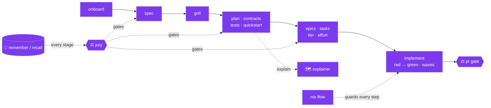
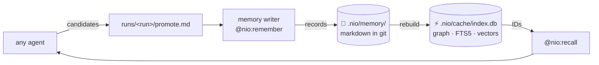

  

  <b>Ni(kolaj) Orchestrator · New &amp; Improved Orchestrator</b> 
  Agent-agnostic skills that make agent-built software <b>trustworthy</b> and <b>cheaper to build</b>.

  
  
  
  

---

## Mission

Agents build fast, but you can't tell **what they decided, why, or whether it's right**.
Vague requirements are where they start hallucinating, plans drift, and making it safe by
brute force (biggest model, review everything) burns tokens.

NIO fixes that with three ideas:

| | Pillar | What it means |
| --- | --- | --- |
| 🔥 | **Grill** | One question at a time until spec, plan and tasks leave no room for guessing: user stories, *given / when / then*, edge cases, no contradictions. |
| ⚖️ | **Jury** | Byzantine review by independent jurors on different models and hosts. Escalates from 1 cheap juror to 3, so tokens track risk. Money, secrets, DB scripts and anything irreversible always go to you. |
| 🧠 | **Memory** | Every decision is recorded with who, why and when, linked requirement → task → diff → verdict, in plain files in git. |

**Success looks like:** you can read why every autonomous decision was allowed, a run fits
a $100 Claude + $20 Antigravity plan, and specs rarely need rework once building starts.
The full vision is in [NORTH_STAR.md](NORTH_STAR.md).

## Where we are

The whole pipeline is built, from onboarding to the pr gate, and NIO builds itself with it:
every change in this repo since late October went spec → grill → jury → plan → tasks →
implement → pr gate (`.nio/specs/`, 25+ efforts), and its memory holds 330 records
(55 decisions, 39 change requests, 236 jury verdicts).

A bug fix takes the **lite** route: no spec jury and no plan, straight from a grilled spec to tasks, and it
offers the full flow if the fix outgrows one module. Not built yet: the full auto run (#122), the PR jury
across hosts, and asking which subscriptions you have.

### What changed lately

- **Onboarding** (#49, #140): `@nio:onboard` grills you through six project docs under `.nio/project/`;
  `@nio:reconcile-onboarding` re-grills only the docs whose source files changed. Scans skip git-ignored
  files and refuse secret values from `.env` files (#144, #145).
- **One pr gate per effort** (#139): the jury judges the effort's whole diff once at the end instead of
  one jury per epic, split into per-epic parts when the code diff passes 2,500 lines (#147).
- **Capped jury rounds** (#137): a gate stops at its round cap and shows you the rest as one batch to
  rule on (accept, fix, or one more round), and fix-task loops end. Each gate step runs in a short-lived
  driver agent. Escalation can no longer loop (#147).
- **Speed** (#81, #87, #93, #99): in-process CLI tests, a parallel self-check suite, evidence reuse,
  parallel task **waves**, task test commands scoped to their own tests, and fewer orchestrator calls per gate.
- **Lite path** (#112) for small fixes, with review fixes for forged refuter files, binary-safe wave
  patches and an empty rerun loop (#110).
- **Explainer** (#146): `@nio:explain` turns an approved plan, or any topic, into a short Mermaid explainer.
- **Optional Claude Code mods** (#134–#136, #143): an optional Claude Code part of NIO, offered by `@nio:install`; the skills work the same without them. See [tools/claude-mods](tools/claude-mods/README.md).

## Skills

Skills are plain `SKILL.md` markdown in the open Agent Skills format, invoked as
`@nio:<skill>`, and work unchanged on any host. `nio flow next <slug>` always names the next one to run.

| Skill | What it does |
| --- | --- |
| [`@nio:install`](skills/install/SKILL.md) | Installs the git hooks and agents, and asks whether stage commands run without permission prompts, for you or the whole repo. |
| [`@nio:onboard`](skills/onboard/SKILL.md) | Onboards an existing repo through a grill, one doc at a time, until the six project docs under `.nio/project/` are written and confirmed. |
| [`@nio:reconcile-onboarding`](skills/reconcile-onboarding/SKILL.md) | Brings the project docs back in line after files changed, grilling only on the changed files and the docs they feed. |
| [`@nio:spec`](skills/spec/SKILL.md) | Records your words verbatim and picks the route (full, lite or epic), then the spec-drafter writes a first draft that never guesses: what you didn't say becomes a `[default]` proposal or an open point. |
| [`@nio:grill`](skills/grill/SKILL.md) | Settles a draft one question at a time: looks facts up, asks only decisions (3 options, one recommended), makes small calls as `[agent]` for you to review, and stops when `nio check spec --gate` passes. You can delegate a session to an agent. |
| [`@nio:plan`](skills/plan/SKILL.md) | Turns an approved spec into its plan, contracts, tests and quickstart, from the spec, the architecture and the code. Asks only what nothing upstream settled. |
| [`@nio:tasks`](skills/tasks/SKILL.md) | Breaks the plan into epics and tasks, rates each with a model tier and an effort, and shows you the estimate. |
| [`@nio:implement`](skills/implement/SKILL.md) | Builds the approved tasks, each by a fresh worker from its own pack; the CLI proves every test failed before the code and passes after it. Independent tasks run in parallel waves. |
| [`@nio:jury`](skills/jury/SKILL.md) | Takes a spec, plan, tasks or a finished effort's whole diff (the pr gate) to a verdict: lens subagents judge it, the refuter validates their findings, a confirmed blocker escalates to 3 jurors, and rounds stop at a cap with your ruling. |
| [`@nio:explain`](skills/explain/SKILL.md) | Explains an approved plan, or any topic, as a short Mermaid explainer: a component map, a build order, a flow per journey and a state diagram per table, each with a brief walk-through, then three items to drill into. `explain.format` picks a host diagram skill instead. |
| [`@nio:remember`](skills/remember/SKILL.md) | Writes memory records: decisions, lessons, change requests and jury verdicts. Any agent leaves candidates that one memory writer promotes at the end of a run. |
| [`@nio:recall`](skills/recall/SKILL.md) | Looks memory up in three steps (find IDs, follow links, read at most 5 records) and says how to act on each record's standing. |

The agents behind the skills (spec and tasks drafters, evaluator, 13 juror lenses, refuter, workers per
model tier) are cards in [`src/nio/agents/`](src/nio/agents/), rendered per host by `nio agents sync`.

## Shorthand

Every item NIO writes gets a permanent ID, `<prefix>-<n>`, so a sentence, a test, a task and a verdict can cite each
other. A removed ID is retired, never reused.

**Spec** (`spec.md`)

| ID | Means |
| --- | --- |
| `A-n` | **Actor**: who uses the system and what they want |
| `UJ-n` | **User journey**: an actor's path through the system, step by step |
| `US-n` | **User story**, with a priority (`P1` first) |
| `FR-n` | **Functional requirement**: one `THE SYSTEM SHALL …` sentence |
| `AC-n` | **Acceptance criterion**: a *given / when / then* that proves an FR or story |
| `NFR-n` | **Non-functional requirement**: a measurable quality (speed, size, cost) with a number |
| `SC-n` | **Success criterion**: a measurable outcome, independent of technology |
| `OP-n` | **Open point**: a question still to settle, a fact or a decision |
| `DF-n` | **Deferred point**: what a grill ended without settling; the jury turns it into a finding only you close |
| `RF-n` | **Research finding**: a fact the agent looked up, cited as `[research: RF-n]` |
| `CB-n` · `EB-n` · `UB-n` | Bug-fix spec: **current** (wrong) behaviour, **expected** behaviour, **unchanged** behaviour that must stay |
| `R-n` | Epic spec: one **release slice** of a large effort |

**Plan and tasks**

| ID | Means |
| --- | --- |
| `CT-n` | **Contract**: a component, interface or data shape the plan adds or changes, citing the FRs it serves |
| `TC-n` | **Test case**: the concrete test that proves an AC or NFR, with its level (unit, integration, e2e) |
| `QS-n` | **Quickstart scenario**: a journey run end to end, by script or by hand |
| `E-n` | **Epic**: a group of tasks that delivers one story, in build order |
| `T-n` | **Task**: one worker's unit of work, with its test, files, tier and effort |

**Jury and memory**

| ID | Means |
| --- | --- |
| `J-n` | **Jury finding**: one problem a lens raised, kept in the gate's ledger across rounds |
| `R-YYMMDD-xxxx` | **Run**: one agent session or jury round, with its `promote.md` |
| `D-…` · `V-…` · `L-…` · `C-…` | Memory records: **decision**, **verdict**, **lesson**, **change request**, IDs `<letter>-YYMMDD-xxxx` |

**Tags** at the end of a spec line say where it came from: `[human]` your words, `[default]` the agent's proposal
awaiting you, `[agent]` a small call the agent made for you to review, `[derived: FR-n]` follows from settled items,
`[research: RF-n]` from a lookup, `[deferred: DF-n]` left open.

**Words**

- **Effort**: one spec's whole journey, from spec to pr gate, in `.nio/specs/<YYYY-MM-DD>-<name>/`.
- **Route**: `full` (spec → plan → tasks), `lite` (a bug fix: no spec jury, no plan) or `epic` (split into slices).
- **Gate**: a point where the jury must approve before the effort moves on: spec, plan, tasks and pr.
- **Lens**: one juror's angle (logic, testability, security, conformance…); each runs as its own agent.
- **Refuter**: an agent that tries to disprove each blocker and major finding before you see it.
- **Blocker / major / minor**: a finding's severity; only a confirmed blocker rejects a gate after the first round.
- **Disposition**: how a finding closed: fixed, open question, accepted risk, out of scope or overruled.
- **Round cap**: the most review rounds a gate runs before it hands you the rest as one batch to rule on.
- **Red / green**: a task's test proven failing before the code, then passing after it.
- **Wave**: tasks with no dependency between them, built in parallel.
- **Tier**: the model class a task or agent runs on (cheap, strong, frontier, max), mapped to real models in config.
- **Pack**: the only context a worker or juror gets: its task or lens, the cited spec items and the memory that applies.
- **Driver**: a short-lived agent that runs one stage or gate step and ends.
- **Standing**: how far to trust a memory record: `current`, `approved`, `drifted`, `challenged`, `conflict`, `superseded`.

## How memory works

- **Files in git are the truth.** Four record types: decision, verdict, lesson, change request.
  Records are never edited; a new record supersedes the old one.
- **The index is a cache.** SQLite with graph links, full-text and `sqlite-vec` embeddings
  (`bge-small-en-v1.5`). Delete it and nothing is lost.
- **Standing is derived,** not stored: `current`, `approved`, `drifted`, `challenged`,
  `conflict`, `superseded`… so agents know whether to trust a record.

Full design: [MEMORY_NORTH_STAR.md](MEMORY_NORTH_STAR.md).

## The `nio` CLI

For what skills can't do reliably. Install with `uv tool install .`, or run in this repo with `uv run nio`.
Every command has `--help`.

| Command | Does |
| --- | --- |
| `nio flow start\|next\|done\|brief\|status` | Where each effort is and the skill to run next; a stage moves on only when its guard passes. `status` is one line per effort across worktrees |
| `nio flow claim\|red\|green\|block\|unblock` | Implementing: claim the next ready task (or a wave), prove its test fails, then passes |
| `nio flow approve\|park\|abandon\|seen` | The human's moves: approve the pr gate at a terminal, park or abandon an effort |
| `nio new <type>` | Create a record, or `new spec <name> --route full\|lite\|epic`, `new plan <slug>`, `new tasks <slug>` from templates |
| `nio check [spec\|plan <slug>] [--gate]` | Lint every record, or a spec's or plan's mechanical checks; `--gate` lists the agent calls, deferred points and the lenses the risk flags trigger |
| `nio jury next <slug> <gate>` | Run one gate step: collect lens outputs, check, write the next packs, print the next action |
| `nio jury plan\|collect\|dispose\|rule\|check` | The gate's parts: lenses and budget, the findings ledger, closing a finding, your ruling on a capped batch, the outcome and its verdict record |
| `nio jury evidence\|pack\|files\|changed\|fixcheck` | What jurors read: tests and attacks run in a throwaway copy, per-lens packs, what changed since the last round |
| `nio onboard scan\|start\|confirm\|changed\|reconciled …` | Onboarding: the repo's docs, manifests, IaC and CI with hashes, the docs' progress, and which went stale |
| `nio explain finish <slug>` / `explain topic <text>` | Check and finish a plan's explainer, or start one on a topic |
| `nio task show <slug> T-n` | One task's section, for a worker's pack |
| `nio index [--check]` · `nio query` · `nio get` · `nio pack` | Memory: rebuild the index with conflict checks, find records by text, file or link, print them, and the memory that applies to a piece of work |
| `nio hooks` · `nio allow --personal\|--shared` | Git hooks that refresh the index and check memory; let agents run stage commands without a permission prompt |
| `nio agents sync\|verify` | Render the agent cards for Claude Code and Codex with each tier's model; check runs used the right model |
| `nio usage install\|report` | Timestamp every agent and shell call; a finished effort commits `usage.json` with its time, tokens and attempts |
| `nio status` · `nio run` | Index freshness and onboarding state; start a run and its `promote.md` |

Self-checks: each `tests/test_*.py` runs on its own, e.g. `uv run python tests/test_flow.py` (name a test
to run just that one). `NIO_E2E=1` runs the `*_e2e.py` and lens tests on real models (costly).

## Principles

**Agent-agnostic** (Claude Code first, Antigravity, Cursor, Codex next) · **files and git
are the state** (no daemon, no database of record) · **human in the loop by default**
(autonomy is earned through the jury) · **minimal** (a skill exists only if it's used).

## Docs

- [NORTH_STAR.md](NORTH_STAR.md): the vision, pipeline, jury and principles.
- [MEMORY_NORTH_STAR.md](MEMORY_NORTH_STAR.md): the memory build spec.
- [GitHub issues](https://github.com/nikolajkarpic/nio/issues): open decisions and the backlog.
- [CLAUDE.md](CLAUDE.md): instructions for agents working in this repo.
- [tools/claude-mods](tools/claude-mods/README.md): optional Claude Code mods (background commands, status pane), installed by `@nio:install` or `nio mods install`.
