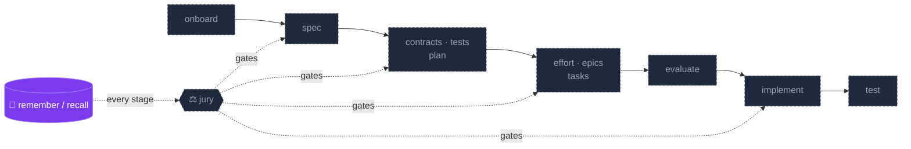
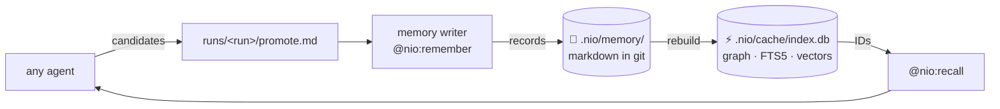

  

  <b>Ni(kolaj) Orchestrator · New &amp; Improved Orchestrator</b> 
  Agent-agnostic skills that make agent-built software <b>trustworthy</b> and <b>cheaper to build</b>.

  
  
  
  

---

## Mission

Agents build fast, but you can't tell **what they decided, why, or whether it's right**.
Vague requirements are where they start hallucinating, plans drift, and making it safe by
brute force (biggest model, review everything) burns tokens.

NIO fixes that with three ideas:

| | Pillar | What it means |
| --- | --- | --- |
| 🔥 | **Grill** | One question at a time until spec, plan and tasks leave no room for guessing: user stories, *given / when / then*, edge cases, no contradictions. |
| ⚖️ | **Jury** | Byzantine review by independent jurors on different models and hosts. Escalates from 1 cheap juror to 3, so tokens track risk. Money, secrets, DB scripts and anything irreversible always go to you. |
| 🧠 | **Memory** | Every decision is recorded with who, why and when, linked requirement → task → diff → verdict, in plain files in git. |

**Success looks like:** you can read why every autonomous decision was allowed, a run fits
a $100 Claude + $20 Antigravity plan, and specs rarely need rework once building starts.
The full vision is in [NORTH_STAR.md](NORTH_STAR.md).

## Where we are

Memory is the first feature, and NIO already uses it on itself (`.nio/memory/`, 26 records).

Purple is built, grey is planned. `@nio:lite` will be a short path for small fixes.

## Skills

Skills are plain `SKILL.md` markdown in the open Agent Skills format, invoked as
`@nio:<skill>`, and work unchanged on any host.

| Skill | Status | What it does |
| --- | --- | --- |
| [`@nio:remember`](skills/remember/SKILL.md) | ✅ built | Writes memory records: decisions, lessons, change requests and jury verdicts. Dedups against existing records, and lets any agent leave candidates that a single memory writer promotes at the end of a run. |
| [`@nio:recall`](skills/recall/SKILL.md) | ✅ built | Looks memory up in three steps (find IDs, follow links, read at most 5 records) and tells the agent how to act on each record's standing: follow it, verify it, or ask the human. |
| [`@nio:install`](skills/install/SKILL.md) | ✅ built | Installs the git hooks and agents, and asks whether stage commands run without permission prompts, for you or the whole repo. Still planned: asking which subscriptions you have and writing the config. |
| `@nio:onboard` | 🗺️ planned | Captures what the project is and what you want before any other stage runs. |
| [`@nio:spec`](skills/spec/SKILL.md) | 🚧 draft stage built | Records your words verbatim, then the spec-drafter agent (Opus) writes a first spec that never guesses: what you didn't say becomes a `[default]` proposal or an open point, and every sentence you wrote is traced to spec IDs. The grill settles it next. |
| [`@nio:grill`](skills/grill/SKILL.md) | ✅ built | Settles a draft spec one question at a time: looks facts up, asks only decisions (3 options, one recommended), writes in what follows, makes the small calls as `[agent]` for you to review, and stops when `nio check spec --gate` passes and you confirm. You can delegate a session to an agent. Ending early defers what's unsettled to `## Deferred`; the jury turns each deferred point into a finding only you close. |
| `@nio:plan` | 🗺️ planned | Contracts, bindings and a concrete test per acceptance criterion, then the plan. |
| `@nio:tasks` | 🗺️ planned | Breaks the plan into effort → epics → tasks, rates difficulty and estimates usage. |
| `@nio:implement` | 🗺️ planned | NIO's workers (TDD, builder, adversarial tester, swarm) build epic by epic. |
| [`@nio:jury`](skills/jury/SKILL.md) | ✅ built (spec gate) | Takes a settled spec to a verdict: picks lenses from the risk flags and size, runs each as an independent agent with a fresh pack, validates findings with the refuter, escalates a confirmed blocker to 3 jurors, fixes what it may and sends behaviour changes back through the grill, then records the verdict. |
| `@nio:lite` | 🗺️ planned | Repro, failing test, fix, jury: for small fixes. |

Planned names follow NORTH_STAR.md and may change; open decisions live in GitHub issues.

## How memory works

- **Files in git are the truth.** Four record types: decision, verdict, lesson, change request.
  Records are never edited; a new record supersedes the old one.
- **The index is a cache.** SQLite with graph links, full-text and `sqlite-vec` embeddings
  (`bge-small-en-v1.5`). Delete it and nothing is lost.
- **Standing is derived,** not stored: `current`, `approved`, `drifted`, `challenged`,
  `conflict`, `superseded`… so agents know whether to trust a record.

Full design: [MEMORY_NORTH_STAR.md](MEMORY_NORTH_STAR.md).

## The `nio` CLI

For what skills can't do reliably. Install with `uv tool install .`, or run in this repo with `uv run nio`.

| Command | Does |
| --- | --- |
| `nio new <type> --area A --title T` | Create a record from its template |
| `nio new spec <name> [--route full\|lite\|epic] [--epic E/R-n]` | Create `.nio/specs/<YYYY-MM-DD>-<name>/spec.md` (the dated folder is the slug) from the slice, bugfix or epic template |
| `nio check` | Lint every record; only `paths` may change on committed ones |
| `nio check spec <slug> [--gate]` | A spec's mechanical checks: sections, permanent IDs, provenance, AC coverage, SHALL, complete tables, the glossary's banned synonyms. Accepts the grill's `[agent]`, `[derived: …]` (only from answered, agent-decided or researched points) and `[deferred: DF-n]` (with its `## Deferred` entry); `--gate` lists the agent calls, derived items and deferred points, and prints the lenses its risk flags trigger |
| `nio index [--check]` | Rebuild the index (incremental) and run cross-branch conflict checks |
| `nio query "<question>" [--path F] [--graph ID]` | Find records by text or file, or walk links; `≈` marks a likely duplicate |
| `nio get <ID>...` | Print records by ID |
| `nio pack "<work>" [--path F] [--ac A] [--diff REF] [--run R]` | The memory that applies to a piece of work, for an agent to read before it starts |
| `nio hooks` | Install git hooks: refresh the index and agent files after pulls, checkouts and rebases; run the CI check before commits and pushes |
| `nio allow --personal\|--shared` | Let agents run stage commands without a permission prompt on Claude Code, in the gitignored or the committed settings file. The human's decisions, `nio flow red` and `green` still prompt |
| `nio agents sync` | Render the agent cards (shipped, `~/.nio/agents/`, `.nio/agents/`) as `.claude/agents/nio-*` and `.codex/agents/nio-*`, with each tier's model from config |
| `nio agents verify` | Check that recent Claude runs of `nio-*` agents used the model their tier maps to |
| `nio jury plan <slug> <gate> [--add lens:reason]` | The lenses a gate needs and why, the risk tier, the run budget; fails if the spec isn't gated or a card is missing |
| `nio jury changed <slug> <gate>` | After a fix: the IDs and sections that changed since the judged version, their neighbours, and the lenses to re-run |
| `nio jury fixcheck <slug> <gate> --lens L [--blocker J-n]` | After the first review: one lens's fix-check pack (its fixed findings, the changed text before and after, the neighbours); the lens answers fixed or not fixed per finding and raises only blockers. `--blocker` is an escalation juror's pack |
| `nio jury template` | Print the lens output format, for a juror's pack |
| `nio jury answers <slug>` | The human's grill answers (each question and the answer chosen), for the scope lens's pack |
| `nio jury collect <slug> <gate> --run R` | Merge the run's lens outputs into the findings ledger (grounded, deduped, matched to earlier rounds) and print the refuter batch; at the spec gate it also adds one finding per deferred point (a contradiction is a blocker). Run again once the refuter has answered |
| `nio jury dispose <slug> <gate> J-n <disposition> --by agent\|grill\|human --note N` | Close a finding: spec-fix, open-question, accepted-risk, out-of-scope or overruled (the last three only by the human; overruled only on a finding the final fix check flagged, when the human can see it is fixed). A deferred finding never closes `--by agent`, and a spec-fix on it waits until its DF line is gone; `--by grill` means the human answered the settling question |
| `nio jury check <slug> <gate> [--record] [--human REASON]` | The gate outcome (approved, rejected, human, or rerun/pending), with the verdict record written to memory on `--record`; `--human` is the human closing the gate themselves. After the first review only a confirmed blocker rejects: the rest goes to the human as one list, then one final fix check |
| `nio status` | Index freshness against `HEAD` |
| `nio run` | Start a run and its `promote.md` |

Self-checks: `uv run python tests/test_records.py`, `tests/test_index.py`, `tests/test_pack.py`, `tests/test_hooks.py`, `tests/test_agents.py`, `tests/test_jury.py` and `tests/test_spec.py`.

## Principles

**Agent-agnostic** (Claude Code first, Antigravity, Cursor, Codex next) · **files and git
are the state** (no daemon, no database of record) · **human in the loop by default**
(autonomy is earned through the jury) · **minimal** (a skill exists only if it's used).

## Docs

- [NORTH_STAR.md](NORTH_STAR.md): the vision, pipeline, jury and principles.
- [MEMORY_NORTH_STAR.md](MEMORY_NORTH_STAR.md): the memory build spec.
- [GitHub issues](https://github.com/nikolajkarpic/nio/issues): open decisions and the backlog.
- [CLAUDE.md](CLAUDE.md): instructions for agents working in this repo.
