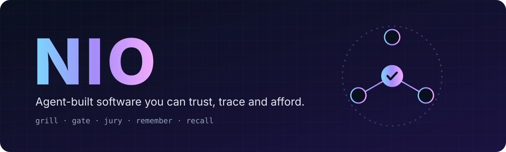
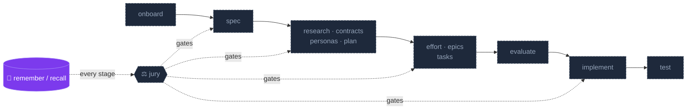
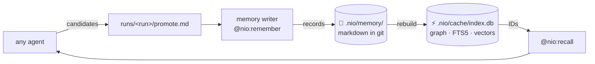

  

  <b>Ni(kolaj) Orchestrator · New &amp; Improved Orchestrator</b> 
  Agent-agnostic skills that make agent-built software <b>trustworthy</b> and <b>cheaper to build</b>.

  
  
  
  

---

## Mission

Agents build fast, but you can't tell **what they decided, why, or whether it's right**.
Vague requirements are where they start hallucinating, plans drift, and making it safe by
brute force (biggest model, review everything) burns tokens.

NIO fixes that with three ideas:

| | Pillar | What it means |
| --- | --- | --- |
| 🔥 | **Grill** | One question at a time until spec, plan and tasks leave no room for guessing: user stories, *given / when / then*, edge cases, no contradictions. |
| ⚖️ | **Jury** | Byzantine review by independent jurors on different models and hosts. Escalates from 1 cheap juror to 3, so tokens track risk. Money, secrets, DB scripts and anything irreversible always go to you. |
| 🧠 | **Memory** | Every decision is recorded with who, why and when, linked requirement → task → diff → verdict, in plain files in git. |

**Success looks like:** you can read why every autonomous decision was allowed, a run fits
a $100 Claude + $20 Antigravity plan, and specs rarely need rework once building starts.
The full vision is in [NORTH_STAR.md](NORTH_STAR.md).

## Where we are

Memory is the first feature, and NIO already uses it on itself (`.nio/memory/`, 26 records).

Purple is built, grey is planned. `@nio:lite` will be a short path for small fixes.

## Skills

Skills are plain `SKILL.md` markdown in the open Agent Skills format, invoked as
`@nio:<skill>`, and work unchanged on any host.

| Skill | Status | What it does |
| --- | --- | --- |
| [`@nio:remember`](skills/remember/SKILL.md) | ✅ built | Writes memory records: decisions, lessons, change requests and jury verdicts. Dedups against existing records, and lets any agent leave candidates that a single memory writer promotes at the end of a run. |
| [`@nio:recall`](skills/recall/SKILL.md) | ✅ built | Looks memory up in three steps (find IDs, follow links, read at most 5 records) and tells the agent how to act on each record's standing: follow it, verify it, or ask the human. |
| `@nio:install` | 🗺️ planned | Asks which subscriptions you have, checks each host CLI and writes the config. |
| `@nio:onboard` | 🗺️ planned | Captures what the project is and what you want before any other stage runs. |
| `@nio:spec` | 🗺️ planned | Grills you into a spec with user stories, edge cases and *given / when / then*. |
| `@nio:plan` | 🗺️ planned | Research, requirements, personas, contracts and bindings, then the plan. |
| `@nio:tasks` | 🗺️ planned | Breaks the plan into effort → epics → tasks, rates difficulty and estimates usage. |
| `@nio:implement` | 🗺️ planned | NIO's workers (TDD, builder, adversarial tester, swarm) build epic by epic. |
| `@nio:jury` | 🗺️ planned | Triage, then 1 → 3 independent jurors; 2 of 3 decide, disagreement goes to you. |
| `@nio:lite` | 🗺️ planned | Repro, failing test, fix, jury: for small fixes. |

Planned names follow NORTH_STAR.md and may change; open decisions live in GitHub issues.

## How memory works

- **Files in git are the truth.** Four record types: decision, verdict, lesson, change request.
  Records are never edited; a new record supersedes the old one.
- **The index is a cache.** SQLite with graph links, full-text and `sqlite-vec` embeddings
  (`bge-small-en-v1.5`). Delete it and nothing is lost.
- **Standing is derived,** not stored: `current`, `approved`, `drifted`, `challenged`,
  `conflict`, `superseded`… so agents know whether to trust a record.

Full design: [MEMORY_NORTH_STAR.md](MEMORY_NORTH_STAR.md).

## The `nio` CLI

For what skills can't do reliably. Install with `uv tool install .`, or run in this repo with `uv run nio`.

| Command | Does |
| --- | --- |
| `nio new <type> --area A --title T` | Create a record from its template |
| `nio check` | Lint every record; only `paths` may change on committed ones |
| `nio index [--check]` | Rebuild the index (incremental) and run cross-branch conflict checks |
| `nio query "<question>" [--path F] [--graph ID]` | Find records by text or file, or walk links; `≈` marks a likely duplicate |
| `nio get <ID>...` | Print records by ID |
| `nio status` | Index freshness against `HEAD` |
| `nio run` | Start a run and its `promote.md` |

Self-checks: `uv run python tests/test_records.py` and `uv run python tests/test_index.py`.

## Principles

**Agent-agnostic** (Claude Code first, Antigravity, Cursor, Codex next) · **files and git
are the state** (no daemon, no database of record) · **human in the loop by default**
(autonomy is earned through the jury) · **minimal** (a skill exists only if it's used).

## Docs

- [NORTH_STAR.md](NORTH_STAR.md): the vision, pipeline, jury and principles.
- [MEMORY_NORTH_STAR.md](MEMORY_NORTH_STAR.md): the memory build spec.
- [GitHub issues](https://github.com/nikolajkarpic/nio/issues): open decisions and the backlog.
- [CLAUDE.md](CLAUDE.md): instructions for agents working in this repo.
